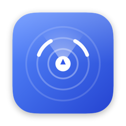
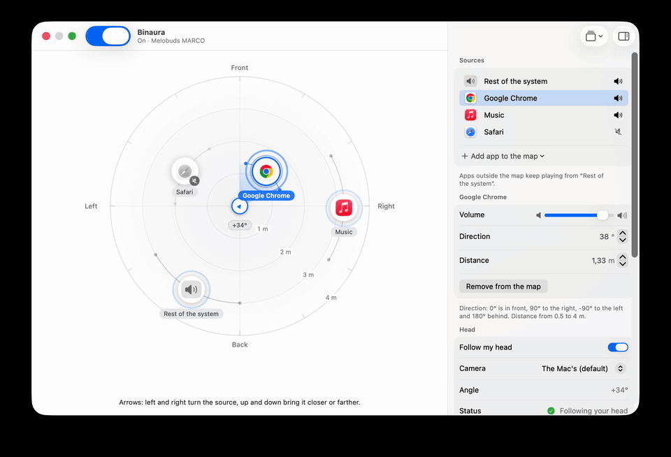
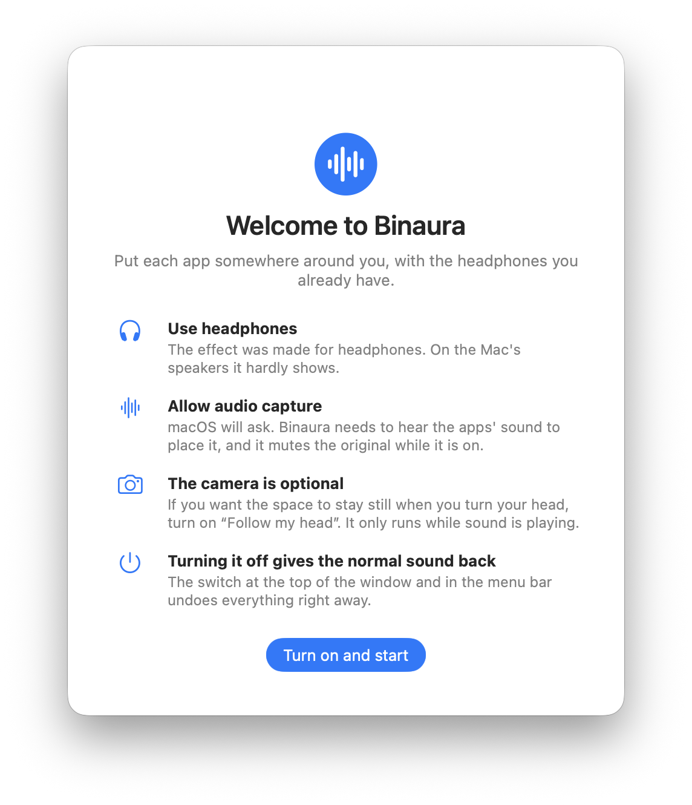
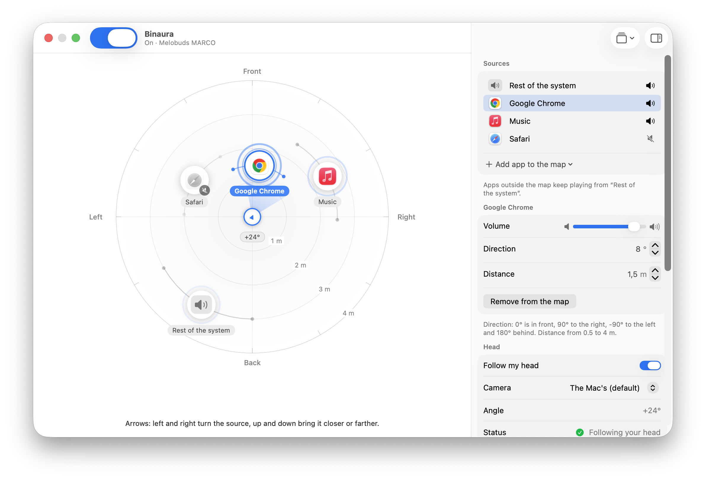
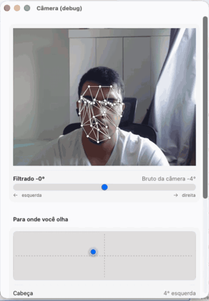
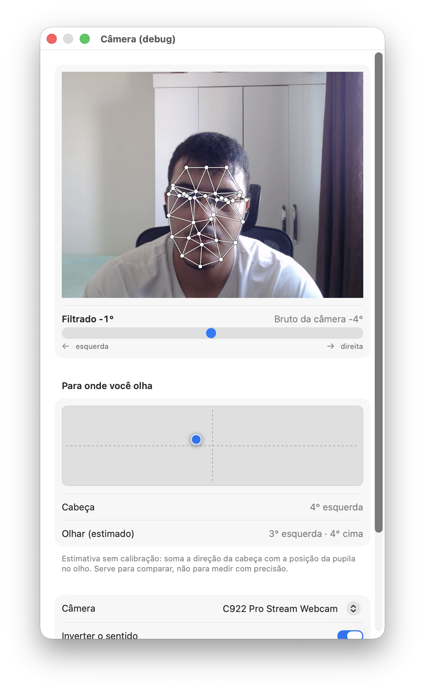
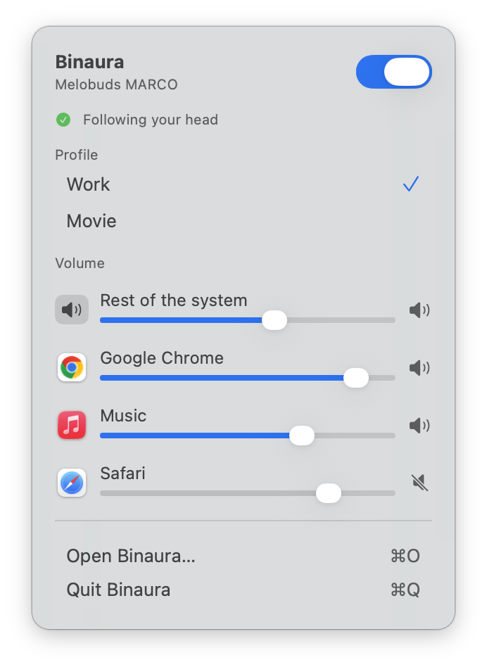
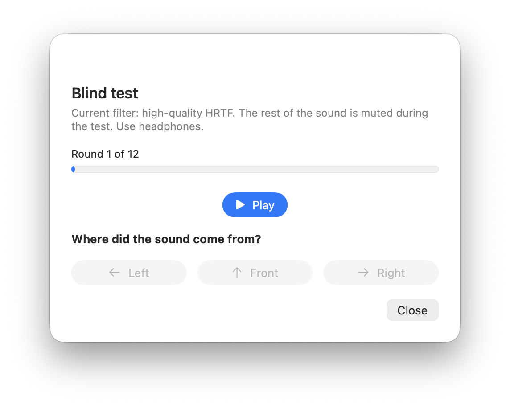

<h1 align="center">
  <br>
  Binaura
</h1>

<p align="center">
  <b>English</b> · <a href="README.pt-BR.md">Português</a>
</p>

<p align="center">
  Spatial audio for any headphones, on your Mac.<br>
  Put each app somewhere around you, and the sound stays put when you turn your head.
</p>

<p align="center">
  <a href="#install"><b>Install</b></a> ·
  <a href="#features"><b>Features</b></a> ·
  <a href="#faq"><b>FAQ</b></a> ·
  <a href="#how-it-was-built"><b>How it was built</b></a> ·
  <a href="LICENSE"><b>MIT license</b></a>
</p>

<p align="center">
  
</p>

## Why

Spatial audio with head tracking is a feature of a few expensive headphones. With any other Bluetooth headphones, a Mac plays everything inside your head, from the same two points: the browser, the music and the call all sound like they come from the same place.

Binaura gives that effect to the headphones you already have. Every app becomes a source you can place on a map around you: the video in front, the music to the right, the chat behind. The sound is rendered for two ears (this is what *binaural* means), so you hear each source where you put it. And since your Mac's camera can see your head, the space stays still when you turn it: look to the right, and what was in front of you moves to your left ear, like in real life.

No audio driver, no extra hardware and no account. It was built for, and tested with, a QCY HT05 and a MacBook Air (macOS 26).

## Install

Binaura isn't notarized yet (that needs a paid Apple program), so for now you build it yourself. It takes a couple of minutes and doesn't need Xcode.

**Requirements:** a Mac with Apple silicon, macOS 15 or later and the Command Line Tools (`xcode-select --install`).

```sh
git clone https://github.com/MarcoFilho1/binaura.git
cd binaura
./scripts/make-signing-cert.sh   # once: a local certificate, so macOS remembers the permissions
./scripts/install.sh             # builds, installs in /Applications and opens it
```

> [!NOTE]
> **Why a certificate?** macOS remembers the audio and camera permissions by the app's signature. An unsigned build changes its signature every time you rebuild, and macOS asks again. `make-signing-cert.sh` creates a certificate that only exists on your Mac (it isn't an Apple one) so the signature stays the same. If you skip it, everything works; you will just be asked for the permissions after each install. The first time, macOS may ask if `codesign` can use the key: choose **Always Allow**.

### First run

<p align="center">
  <picture>
    <source media="(prefers-color-scheme: dark)" srcset="docs/media/en/welcome-dark.png">
    
  </picture>
</p>

The welcome window explains what Binaura does and what it will ask for. Nothing changes in your sound until you press **Turn on and start**. Then macOS asks for permission to capture audio (Binaura needs to hear the apps to place them). The camera permission only comes if you turn on **Follow my head**.

> [!TIP]
> **Always one click from normal.** The switch at the top of the window and in the menu bar turns everything off: the original sound comes back right away.

## Features

### Put every app where you want it

The map shows the space around you from above, with you in the middle looking up. Add the apps that are playing, then **drag each one** to a new place: the closer it is, the louder it gets, and the direction changes where the sound comes from. Everything else keeps playing from the **Rest of the system** source. The rings pulse with each source's level, so you can see who is making noise.

<p align="center">
  <picture>
    <source media="(prefers-color-scheme: dark)" srcset="docs/media/en/main-dark.png">
    
  </picture>
</p>

Prefer the keyboard? Select a source and use the arrow keys, or type the direction and distance in the inspector (0° is in front, 90° to your right, 180° behind). Every source is labeled for VoiceOver.

### The space stays still when you turn your head

Turn on **Follow my head** and the camera measures how much you turned. The sound field turns the opposite way, so each app stays where you put it. The camera only runs while something is playing, and the angle is smoothed so the sound never jumps.

<p align="center">
  
</p>

### See exactly what the camera sees

The **Camera debug** window draws a mesh of about 40 points on your face, the head angle (raw and smoothed) and a small screen with an estimate of where you are looking. It's there to check that tracking works in your light and with your camera, and to calibrate the center: look at the screen and press **Calibrate center**.

<p align="center">
  <picture>
    <source media="(prefers-color-scheme: dark)" srcset="docs/media/camera-debug-dark.png">
    
  </picture>
</p>

### Everyday use from the menu bar

Most of the time you don't need the window. The menu bar panel turns the effect on and off, switches **profiles** (for example *Work* and *Movie*, each with its own positions) and sets the volume of every source.

<p align="center">
  <picture>
    <source media="(prefers-color-scheme: dark)" srcset="docs/media/en/menu-dark.png">
    
  </picture>
</p>

### Tune the sound

- **Stereo as two virtual speakers.** Each app is placed as a left and a right channel, a few degrees apart (30° by default), so music keeps its width. Set it to 0° to collapse each app into a single point.
- **Room reverb** with an adjustable level.
- **Four direction filters**: high-quality HRTF (the default), HRTF, spherical head, and plain panning. They sound different on different ears; pick the one that sounds most natural to you.
- **A blind test.** A short burst of noise plays from the left, front or right, and you say where it came from. Run it with each filter and keep the best one.

<p align="center">
  <picture>
    <source media="(prefers-color-scheme: dark)" srcset="docs/media/en/blind-test-dark.png">
    
  </picture>
</p>

### Safe by design

Binaura silences the original sound of the apps it places, so it has to be careful never to leave you without sound.

- Unplug your headphones, or switch the output in the Mac, and Binaura rebuilds itself on the new device within a second or so.
- Turning it off, or quitting the app, gives the normal sound back right away.
- Permission denied? The window says so and takes you to the right Settings pane.

### More

- **Another device as a source.** A second Mac can send its audio over your local network to appear on the map as one more source. It's a minimal version: unencrypted (a password only keeps other devices out), so use it on a network you trust.
- **Open at login**, and a menu bar icon that shows when something needs attention.
- **English and Portuguese.** The interface follows your Mac's language. To pick one yourself, open **Profiles and advanced → Language** and reopen the app.
- **Light and dark mode**, and it respects *Reduce motion*.

## FAQ

**Does it work with any headphones?** Yes, any output. The effect is designed for headphones: on the Mac's speakers the two ears hear a mix of both speakers, and most of the spatial cues are lost.

**Do I need AirPods?** No. AirPods already have their own spatial audio with head tracking; Binaura is for all the other headphones. It also works with AirPods, but there is little reason to use both.

**Which languages does it speak?** English and Portuguese. It follows the language of your Mac, and you can change it in **Profiles and advanced → Language** (the app reopens to apply it). Other languages fall back to English.

**Does it install an audio driver?** No. It uses the system's Core Audio tap (macOS 14.2 and later) to hear what each app plays, and plays the result itself.

**Why does macOS ask for audio and camera permissions?** The first is needed to hear the apps and place them. The second is only for following your head, and it's optional.

**Does it record or send my face?** No. The camera frames are analyzed on the Mac and thrown away; nothing is saved and nothing leaves the Mac. The only network feature is the optional one that receives audio from another device.

**Is there a delay?** Bluetooth adds the biggest one: about 160 ms on the author's headphones, as reported by macOS. A video player that compensates for Bluetooth delay keeps picture and sound together; so does a headphone with a low-latency or game mode. Binaura's own delay hasn't been measured yet (it's on the roadmap).

**Does the sound follow my head right away?** With a small lag: the camera and the face analysis take a moment. In daily use the space feels stable, but it isn't instant.

**It asks for the permissions again after I update.** Run `./scripts/make-signing-cert.sh` once, then always install with `./scripts/install.sh`.

## Battery

The camera only turns on while something is playing, and turns off after 10 seconds of silence. If you don't use head tracking, the camera isn't used at all.

## Privacy

Everything runs on your Mac. The camera frames are processed in memory and never stored or sent. The settings (positions, volumes and profiles) are one small file in `~/Library/Application Support/Binaura`. There is no account, no analytics and no network use, except the optional receiver of another device's audio (off by default).

## How it works

```
Apps ──▶ Core Audio tap ──▶ Binaura ──▶ HRTF, one pair of virtual speakers per app ──▶ your headphones
          (silences the                      ▲
           original)                         │ rotates the space
Camera ──▶ Vision (face points) ──▶ continuous head angle ──▶ smoothing
```

- **Capture.** One Core Audio tap per placed app (and one for the rest of the system, which leaves out Binaura itself so it never hears its own output). Each tap lives in a private aggregate device, and the original sound is muted.
- **Rendering.** `AVAudioEngine` with an `AVAudioEnvironmentNode` and the high-quality HRTF. Each source's two channels are placed as two points in space; the head angle rotates the listener.
- **Head angle.** Vision finds 76 points on the face. Binaura uses their geometry to estimate the angle (see below) and smooths it.
- **Recovery.** When the output device changes, Binaura stops, gives the sound back to the apps and starts again on the new device.

## How it was built

Binaura was built in phases, each one a branch with a short checklist, and each one proved with measurements before the next started.

| Phase | What was built | How it was checked |
|---|---|---|
| 0 | Capture the system sound and play it again | A test mode that plays only in the left ear proved the path |
| 1 | One source in 3D space | An offline render at 6 angles: at 90° the right ear gets the sound **14 dB louder and 0.73 ms earlier** |
| 2 | Head tracking with the camera | A filter tested with synthetic sequences: steps, noise, a lost face, calibration |
| 3 | Several sources, per app, and a map | Scene files, map geometry and app grouping tested offline |
| 4 | Reverb, filters, blind test, menu bar | A blind test with 3 positions: **12 out of 12** with the high-quality HRTF |
| 5 | Another device over the network | Packets, password and the audio itself checked over loopback |

### The head angle that jumped

The first head tracking used the angle that Vision reports. It worked, but the sound jumped 20 to 45° at a time. Instead of smoothing harder, we recorded 35 seconds of a head turning slowly and looked at the numbers:

| | Vision's angle | Angle from the face geometry |
|---|---|---|
| Distinct values in the recording | **3** (0°, 45°, 90°) | **78** |
| Largest jump between two frames | 45° | 13° (5° after smoothing) |

Vision's `yaw` is a classifier with three positions, not an angle. The fix was to compute a continuous one from two ratios of the face points, where the center line of the face and the middle of the eyes sit between the edges of the jaw. Where Vision said "45°", the new estimate averaged 43°, so the scale matches. The ratio-to-angle constants come from that recording, and the estimator has its own tests.

### Testing without the headphones

Most of the audio work can't be judged by ear in an automated test, so `binaura-check` renders the 3D engine offline and measures it: level and timing difference between the ears per angle, loudness drop with distance, the virtual stereo speakers, the head rotation sign, the smoothing filter, the face mesh triangulation (Delaunay), the saved scene, and the network packets. There are **68 checks** and they run in a few seconds.

### The interface

The UI is native SwiftUI (unified toolbar, inspector, grouped forms, a menu bar extra), with the app icons of the apps you place as the sources. It went through three rounds of independent review, which found real problems: the app turned the effect on before the welcome window, a permission error that was hidden in the menu bar, keyboard focus that disappeared, and a level indicator that vanished with *Reduce motion*. The icon is drawn in code, and the screenshots and GIFs in this README are made by the app itself in a demo mode (`scripts/shoot.sh`), with sample data.

## Roadmap

- A signed and notarized download, so you don't have to build it.
- A harder blind test, with front, back and in-between positions.
- Measure the real latency (Binaura's own and the headphone's) and show it.
- Intel Macs (not tested).

## Develop

```
Sources/BinauraCore/   audio engine, taps, head tracking, face mesh, scene (no UI)
Sources/BinauraApp/    the SwiftUI app: stage, inspector, menu bar, camera debug, welcome
Sources/binaura/       command line version (tests of the sound path and the camera)
Sources/binaura-check/ the offline checks
scripts/               build, install, signing certificate, icon, screenshots
```

```sh
swift run binaura-check          # the 68 offline checks (no headphones, no camera)
./scripts/build-app.sh           # builds build/Binaura.app and build/BinauraCLI.app
./scripts/install.sh             # installs in /Applications
./scripts/make-icon.sh           # redraws the icon (Resources/AppIcon.icns)
./scripts/shoot.sh main out.png  # a screenshot of a demo window (needs the Screen Recording permission)
```

Requires macOS 15 or later and Swift 6 (the Command Line Tools are enough). Design decisions are in [DESIGN.md](DESIGN.md) and the manual checklist is in [VALIDACAO.md](VALIDACAO.md).

## License

[MIT](LICENSE)
