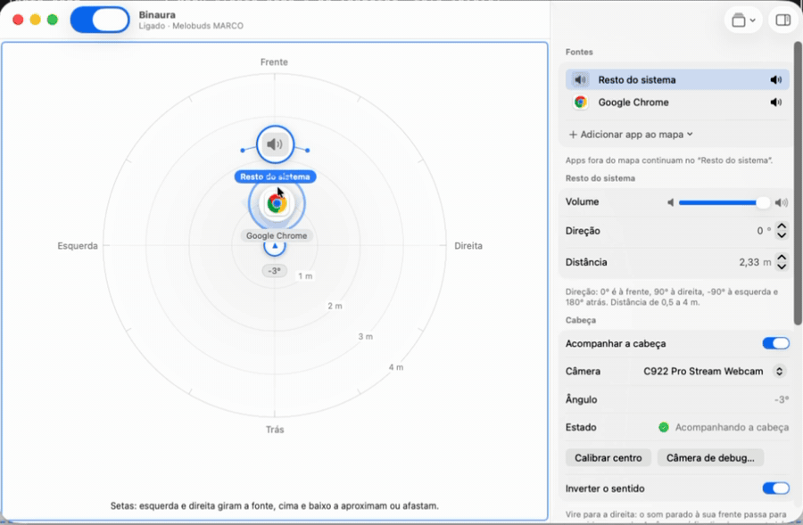
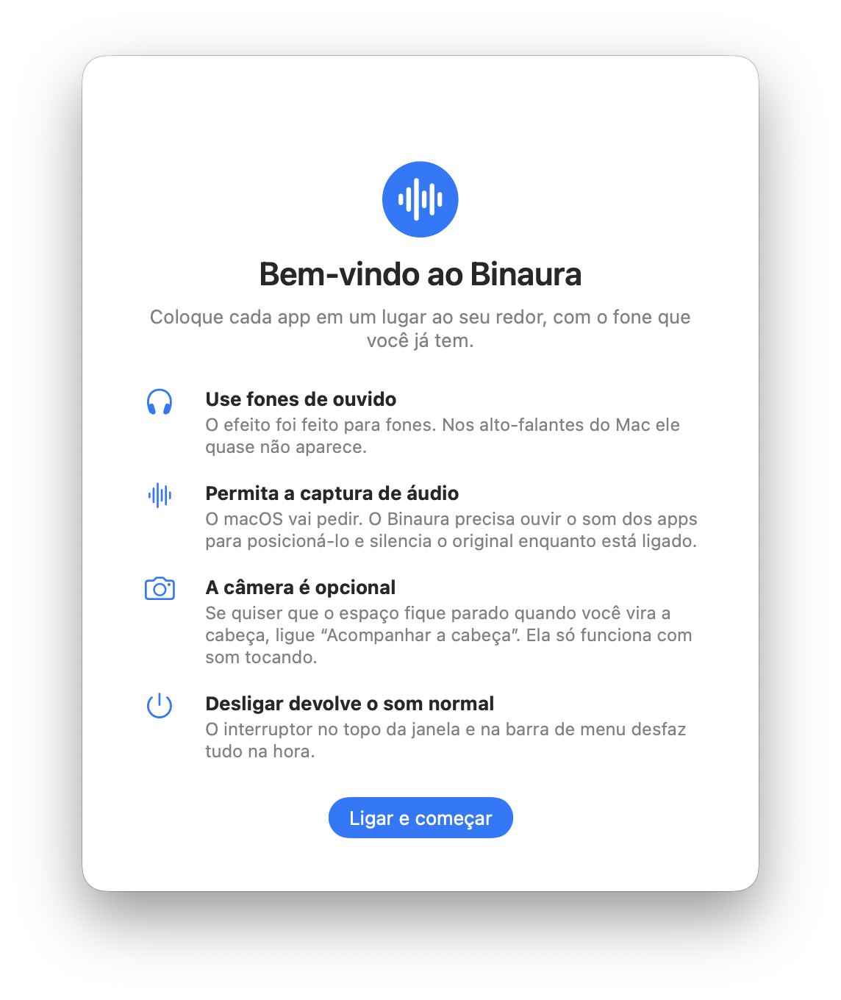
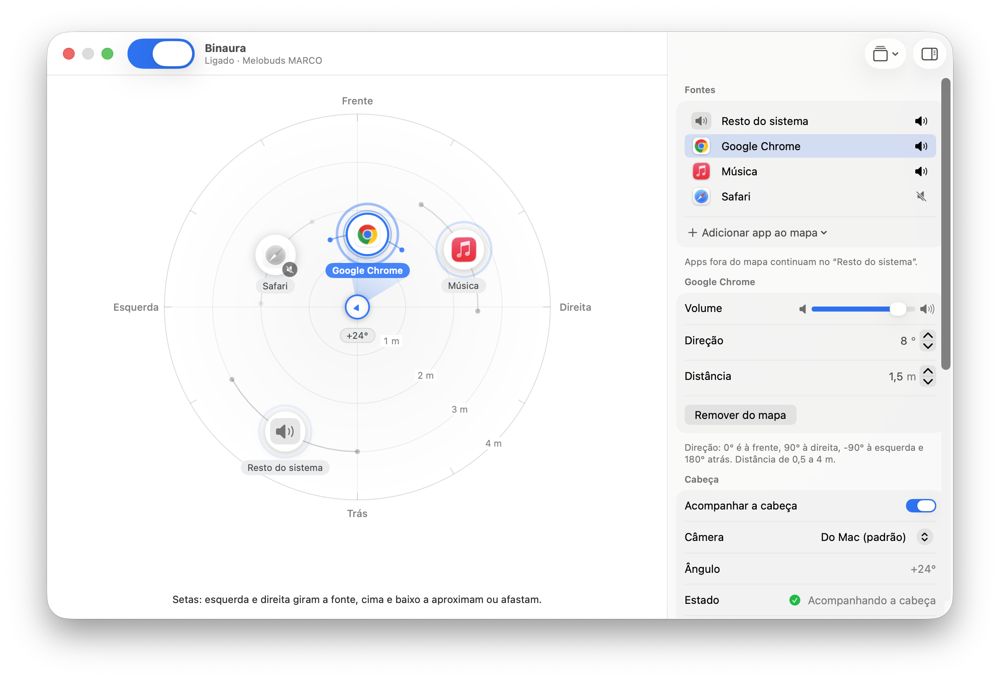
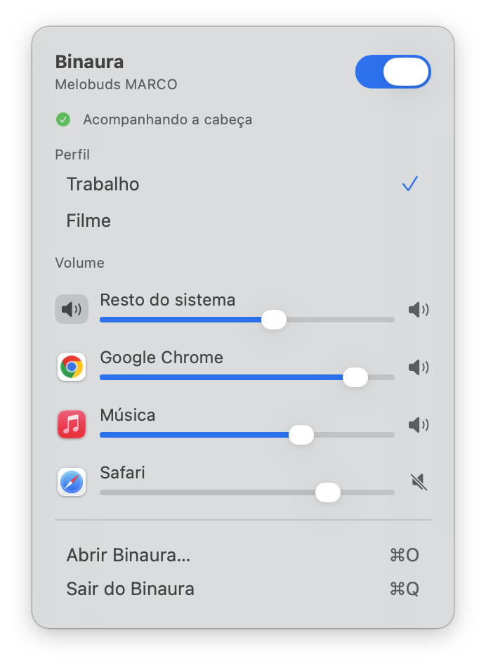
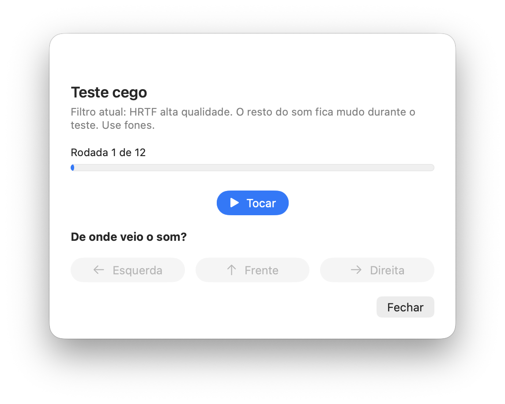

<h1 align="center">
  <br>
  Binaura
</h1>

<p align="center">
  <a href="README.md">English</a> · <b>Português</b>
</p>

<p align="center">
  Áudio espacial para qualquer fone de ouvido, no seu Mac.<br>
  Coloque cada app em um lugar ao seu redor, e o som fica parado quando você vira a cabeça.
</p>

<p align="center">
  <a href="#instalação"><b>Instalação</b></a> ·
  <a href="#recursos"><b>Recursos</b></a> ·
  <a href="#perguntas-frequentes"><b>Perguntas frequentes</b></a> ·
  <a href="#como-foi-feito"><b>Como foi feito</b></a> ·
  <a href="LICENSE"><b>Licença MIT</b></a>
</p>

<p align="center">
  
</p>

## Por quê

O áudio espacial com rastreio de cabeça é um recurso de poucos fones caros. Com qualquer outro fone Bluetooth, o Mac toca tudo dentro da sua cabeça, dos mesmos dois pontos: o navegador, a música e a chamada de vídeo parecem vir do mesmo lugar.

O Binaura dá esse efeito aos fones que você já tem. Cada app vira uma fonte que você posiciona em um mapa ao seu redor: o vídeo na frente, a música à direita, o chat atrás. O som é gerado para dois ouvidos (é isso que *binaural* quer dizer), então você ouve cada fonte onde a colocou. E como a câmera do Mac enxerga a sua cabeça, o espaço fica parado quando você a vira: olhe para a direita, e o que estava na sua frente passa para o ouvido esquerdo, como na vida real.

Sem driver de áudio, sem hardware extra e sem conta. Foi feito para, e testado com, um QCY HT05 e um MacBook Air (macOS 26).

## Instalação

O Binaura ainda não é notarizado (isso exige um programa pago da Apple), então por enquanto você o compila. Leva alguns minutos e não precisa do Xcode.

**Requisitos:** um Mac com Apple silicon, macOS 15 ou mais novo e as Command Line Tools (`xcode-select --install`).

```sh
git clone https://github.com/MarcoFilho1/binaura.git
cd binaura
./scripts/make-signing-cert.sh   # uma vez: um certificado local, para o macOS lembrar as permissões
./scripts/install.sh             # compila, instala em /Applications e abre
```

> [!NOTE]
> **Por que um certificado?** O macOS lembra as permissões de áudio e câmera pela assinatura do app. Uma compilação sem assinatura estável muda de assinatura a cada vez, e o macOS pergunta de novo. O `make-signing-cert.sh` cria um certificado que só existe no seu Mac (não é da Apple) para a assinatura ficar sempre igual. Se você pular essa etapa, tudo funciona; só que as permissões serão pedidas depois de cada instalação. Na primeira vez, o macOS pode perguntar se o `codesign` pode usar a chave: escolha **Permitir sempre**.

### Primeira execução

<p align="center">
  <picture>
    <source media="(prefers-color-scheme: dark)" srcset="docs/media/welcome-dark.png">
    
  </picture>
</p>

A janela de boas-vindas explica o que o Binaura faz e o que ele vai pedir. Nada muda no seu som até você apertar **Ligar e começar**. Aí o macOS pede permissão para capturar áudio (o Binaura precisa ouvir os apps para posicioná-los). A permissão da câmera só vem se você ligar **Acompanhar a cabeça**.

> [!TIP]
> **Sempre a um clique do normal.** O interruptor no topo da janela e na barra de menu desliga tudo: o som original volta na hora.

## Recursos

### Coloque cada app onde quiser

O mapa mostra o espaço ao seu redor visto de cima, com você no centro olhando para cima. Adicione os apps que estão tocando e **arraste cada um** para um novo lugar: quanto mais perto, mais alto, e a direção muda de onde o som vem. Todo o resto continua tocando pela fonte **Resto do sistema**. Os anéis pulsam com o nível de cada fonte, então dá para ver quem está fazendo barulho.

<p align="center">
  <picture>
    <source media="(prefers-color-scheme: dark)" srcset="docs/media/main-dark.png">
    
  </picture>
</p>

Prefere o teclado? Selecione uma fonte e use as setas, ou digite a direção e a distância no inspetor (0° é à frente, 90° à sua direita, 180° atrás). Cada fonte tem legenda para o VoiceOver.

### O espaço fica parado quando você vira a cabeça

Ligue **Acompanhar a cabeça** e a câmera mede quanto você virou. O campo sonoro gira no sentido contrário, e cada app fica onde você o colocou. A câmera só funciona enquanto algo está tocando, e o ângulo é suavizado para o som nunca dar saltos.

<p align="center">
  
</p>

### Veja exatamente o que a câmera vê

A janela **Câmera de debug** desenha uma malha de cerca de 40 pontos no seu rosto, o ângulo da cabeça (bruto e suavizado) e uma tela pequena com uma estimativa de para onde você olha. Serve para conferir se o rastreio funciona com a sua luz e a sua câmera, e para calibrar o centro: olhe para a tela e aperte **Calibrar centro**.

<p align="center">
  <picture>
    <source media="(prefers-color-scheme: dark)" srcset="docs/media/camera-debug-dark.png">
    
  </picture>
</p>

### Uso diário pela barra de menu

Na maior parte do tempo você não precisa da janela. O painel da barra de menu liga e desliga o efeito, troca de **perfil** (por exemplo *Trabalho* e *Filme*, cada um com as suas posições) e ajusta o volume de cada fonte.

<p align="center">
  <picture>
    <source media="(prefers-color-scheme: dark)" srcset="docs/media/menu-dark.png">
    
  </picture>
</p>

### Ajuste o som

- **Estéreo como dois alto-falantes virtuais.** Cada app é posicionado como um canal esquerdo e um direito, alguns graus separados (30° por padrão), e a música mantém a largura. Com 0°, cada app vira um ponto só.
- **Reverberação de sala** com intensidade ajustável.
- **Quatro filtros de direção**: HRTF de alta qualidade (o padrão), HRTF, cabeça esférica e só pan. Soam diferente em ouvidos diferentes; escolha o que soa mais natural para você.
- **Um teste cego.** Um chiado curto toca da esquerda, da frente ou da direita, e você diz de onde veio. Faça com cada filtro e fique com o melhor.

<p align="center">
  <picture>
    <source media="(prefers-color-scheme: dark)" srcset="docs/media/blind-test-dark.png">
    
  </picture>
</p>

### Seguro por princípio

O Binaura silencia o som original dos apps que ele posiciona, então precisa ter cuidado para nunca deixar você sem som.

- Desconecte os fones, ou troque a saída no Mac, e o Binaura se reconstrói no novo dispositivo em cerca de um segundo.
- Desligar, ou fechar o app, devolve o som normal na hora.
- Permissão negada? A janela avisa e leva você ao painel certo dos Ajustes.

### E mais

- **Outro dispositivo como fonte.** Um segundo Mac pode enviar o áudio dele pela sua rede local e aparecer no mapa como mais uma fonte. É uma versão mínima: sem criptografia (uma senha só impede outros dispositivos de entrar), então use em uma rede de confiança.
- **Abrir ao iniciar o Mac**, e um ícone na barra de menu que avisa quando algo precisa de atenção.
- **Português e inglês.** A interface acompanha o idioma do seu Mac. Para escolher um, abra **Perfis e avançado → Idioma** e reabra o app.
- **Modo claro e escuro**, e ele respeita *Reduzir movimento*.

## Perguntas frequentes

**Funciona com qualquer fone?** Sim, qualquer saída. O efeito foi feito para fones: nos alto-falantes do Mac cada ouvido escuta a mistura dos dois alto-falantes, e a maior parte das pistas espaciais se perde.

**Preciso de AirPods?** Não. Os AirPods já têm áudio espacial próprio com rastreio de cabeça; o Binaura é para todos os outros fones. Ele também funciona com AirPods, mas há pouco motivo para usar os dois.

**Em quais idiomas ele fala?** Inglês e português. Ele acompanha o idioma do seu Mac, e você pode trocar em **Perfis e avançado → Idioma** (o app reabre para aplicar). Outros idiomas caem no inglês.

**Instala algum driver de áudio?** Não. Ele usa o *tap* do Core Audio do sistema (macOS 14.2 ou mais novo) para ouvir o que cada app toca, e reproduz o resultado por conta própria.

**Por que o macOS pede permissão de áudio e de câmera?** A primeira é necessária para ouvir os apps e posicioná-los. A segunda é só para acompanhar a cabeça, e é opcional.

**Ele grava ou envia o meu rosto?** Não. Os quadros da câmera são analisados no Mac e descartados; nada é salvo e nada sai do Mac. O único recurso de rede é o opcional, que recebe áudio de outro dispositivo.

**Há atraso?** O Bluetooth adiciona o maior: cerca de 160 ms nos fones do autor, segundo o macOS. Um player de vídeo que compense o atraso do Bluetooth mantém imagem e som juntos; um fone com modo de baixa latência ou modo jogo também ajuda. O atraso do próprio Binaura ainda não foi medido (está no roteiro).

**O som acompanha a cabeça na hora?** Com um pequeno atraso: a câmera e a análise do rosto levam um instante. No dia a dia o espaço parece estável, mas não é instantâneo.

**Ele pede as permissões de novo depois que eu atualizo.** Rode `./scripts/make-signing-cert.sh` uma vez e instale sempre com `./scripts/install.sh`.

## Bateria

A câmera só liga enquanto algo está tocando, e desliga depois de 10 segundos de silêncio. Se você não usa o rastreio da cabeça, a câmera não é usada.

## Privacidade

Tudo roda no seu Mac. Os quadros da câmera são processados na memória e nunca guardados nem enviados. As configurações (posições, volumes e perfis) são um arquivo pequeno em `~/Library/Application Support/Binaura`. Não há conta, nem análise de uso, nem uso de rede, exceto o receptor opcional do áudio de outro dispositivo (desligado por padrão).

## Como funciona

```
Apps ──▶ tap do Core Audio ──▶ Binaura ──▶ HRTF, um par de alto-falantes virtuais por app ──▶ seus fones
          (silencia o                          ▲
           original)                           │ gira o espaço
Câmera ──▶ Vision (pontos do rosto) ──▶ ângulo contínuo da cabeça ──▶ suavização
```

- **Captura.** Um tap do Core Audio por app posicionado (e um para o resto do sistema, que deixa de fora o próprio Binaura para ele nunca ouvir a sua saída). Cada tap vive em um dispositivo agregado privado, e o som original é silenciado.
- **Renderização.** `AVAudioEngine` com um `AVAudioEnvironmentNode` e o HRTF de alta qualidade. Os dois canais de cada fonte viram dois pontos no espaço; o ângulo da cabeça gira o ouvinte.
- **Ângulo da cabeça.** O Vision encontra 76 pontos no rosto. O Binaura usa a geometria deles para estimar o ângulo (veja abaixo) e o suaviza.
- **Recuperação.** Quando o dispositivo de saída muda, o Binaura para, devolve o som aos apps e recomeça no novo dispositivo.

## Como foi feito

O Binaura foi feito em fases, cada uma uma branch com uma checklist curta, e cada uma provada com medições antes de a próxima começar.

| Fase | O que foi feito | Como foi conferido |
|---|---|---|
| 0 | Capturar o som do sistema e tocá-lo de novo | Um modo de teste que toca só no ouvido esquerdo provou o caminho |
| 1 | Uma fonte no espaço 3D | Uma renderização offline em 6 ângulos: a 90° o ouvido direito recebe o som **14 dB mais forte e 0,73 ms antes** |
| 2 | Rastreio da cabeça com a câmera | Um filtro testado com sequências sintéticas: degraus, ruído, rosto perdido, calibração |
| 3 | Várias fontes, por app, e um mapa | Arquivos de cena, geometria do mapa e agrupamento de apps testados offline |
| 4 | Reverberação, filtros, teste cego, barra de menu | Um teste cego com 3 posições: **12 de 12** com o HRTF de alta qualidade |
| 5 | Outro dispositivo pela rede | Pacotes, senha e o próprio áudio conferidos em loopback |

### O ângulo da cabeça que pulava

O primeiro rastreio usava o ângulo que o Vision informa. Funcionava, mas o som pulava de 20 a 45° de uma vez. Em vez de suavizar mais, gravamos 35 segundos de uma cabeça virando devagar e olhamos os números:

| | Ângulo do Vision | Ângulo pela geometria do rosto |
|---|---|---|
| Valores distintos na gravação | **3** (0°, 45°, 90°) | **78** |
| Maior salto entre dois quadros | 45° | 13° (5° depois da suavização) |

O `yaw` do Vision é um classificador de três posições, não um ângulo. A correção foi calcular um ângulo contínuo a partir de duas razões dos pontos do rosto: onde a linha central do rosto e o meio dos olhos ficam entre as bordas do maxilar. Onde o Vision dizia "45°", a nova estimativa teve média de 43°, então a escala bate. As constantes que convertem as razões em ângulo vêm dessa gravação, e o estimador tem testes próprios.

### Testando sem os fones

A maior parte do trabalho de áudio não dá para julgar de ouvido em um teste automatizado, então o `binaura-check` renderiza o motor 3D offline e mede: a diferença de nível e de tempo entre os ouvidos por ângulo, a queda de volume com a distância, os alto-falantes virtuais do estéreo, o sentido da rotação da cabeça, o filtro de suavização, a triangulação da malha do rosto (Delaunay), a cena salva e os pacotes de rede. São **68 verificações**, e rodam em poucos segundos.

### A interface

A interface é SwiftUI nativo (barra de ferramentas unificada, inspetor, formulários agrupados, um item na barra de menu), com os ícones dos apps que você posiciona como as fontes. Ela passou por três rodadas de revisão independente, que acharam problemas reais: o app ligava o efeito antes da janela de boas-vindas, um erro de permissão que ficava escondido na barra de menu, um foco de teclado que sumia e um indicador de nível que desaparecia com *Reduzir movimento*. O ícone é desenhado em código, e os prints e GIFs deste README são feitos pelo próprio app em um modo de demonstração (`scripts/shoot.sh`), com dados de exemplo.

## Roteiro

- Um download assinado e notarizado, para você não precisar compilar.
- Um teste cego mais difícil, com posições à frente, atrás e intermediárias.
- Medir a latência real (a do Binaura e a do fone) e mostrá-la.
- Macs com Intel (não testado).

## Desenvolvimento

```
Sources/BinauraCore/   motor de áudio, taps, rastreio da cabeça, malha do rosto, cena (sem interface)
Sources/BinauraApp/    o app em SwiftUI: palco, inspetor, barra de menu, câmera de debug, boas-vindas
Sources/binaura/       versão de linha de comando (testes do caminho do som e da câmera)
Sources/binaura-check/ as verificações offline
scripts/               compilar, instalar, certificado de assinatura, ícone, prints
```

```sh
swift run binaura-check          # as 68 verificações offline (sem fones, sem câmera)
./scripts/build-app.sh           # gera build/Binaura.app e build/BinauraCLI.app
./scripts/install.sh             # instala em /Applications
./scripts/make-icon.sh           # redesenha o ícone (Resources/AppIcon.icns)
./scripts/shoot.sh main saida.png  # um print de uma janela de demonstração (precisa da permissão de Gravação de Tela)
```

Requer macOS 15 ou mais novo e Swift 6 (as Command Line Tools bastam). As decisões de design estão no [DESIGN.md](DESIGN.md) e a checklist manual no [VALIDACAO.md](VALIDACAO.md).

## Licença

[MIT](LICENSE)
